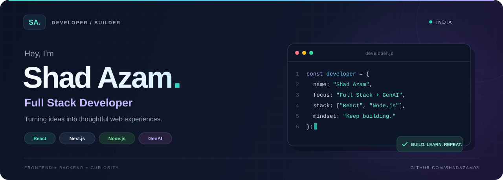

  

  
  
  

  <a href="#about-me">About</a> &nbsp;·&nbsp;
  <a href="#featured-projects">Projects</a> &nbsp;·&nbsp;
  <a href="#tech-stack">Tech Stack</a> &nbsp;·&nbsp;
  <a href="#github-activity">Activity</a> &nbsp;·&nbsp;
  <a href="#lets-connect">Contact</a>

---

## About me

I'm **Shad Azam**, a **Full Stack Developer based in India**. I enjoy turning ideas into web applications, working across the frontend, backend and databases, and exploring what **Generative AI** can bring to the experience.

- 🎧 **Building:** [TuneSphere](https://github.com/shadazam08/tunesphere), a full-stack music streaming platform.
- 🌱 **Learning:** TypeScript, deeper Next.js patterns and GenAI applications.
- 💬 **Ask me about:** JavaScript, React, Node.js, Express, MongoDB and PostgreSQL.
- 🏏 **Beyond the keyboard:** Cricket and experimenting with new project ideas.

## Featured projects

### 01 &nbsp; TuneSphere 🎧

**Your music. Your playlists. Your space.**

A full-stack music streaming platform with user authentication, playlist management and dynamic music streaming.

`React` `Next.js` `Node.js` `Express` `MongoDB`

---

### 02 &nbsp; Meesho Clone 🛍️

**From product discovery to checkout.**

A Meesho-inspired e-commerce platform featuring product listings, user authentication, a shopping cart and order management.

`React` `Node.js` `Express` `MongoDB`

---

### 03 &nbsp; Netflix Clone 🍿

**A familiar interface, built as a learning project.**

A Netflix-inspired web application with user authentication, search and filtering for movies and TV shows.

`React` `Node.js` `Express`

  <a href="https://github.com/shadazam08?tab=repositories">Explore all repositories →</a>

## Tech stack

**Frontend**

**Backend & databases**

**Exploring & learning**

## Currently exploring

| Focus | What I'm working toward |
| :--- | :--- |
| ⚡ Next.js & TypeScript | Building applications with clearer structure and stronger types. |
| ✨ Generative AI | Exploring useful AI features for web applications. |
| 🧩 GraphQL & microservices | Learning how APIs and services fit together as applications grow. |
| 🎨 UI/UX | Making interfaces clearer, more consistent and easier to use. |

## GitHub activity

  

  

## Let's connect

Have an idea, a collaboration in mind or a project to discuss? **I'd love to hear from you.**

📬 **[azamshad08@gmail.com](mailto:azamshad08@gmail.com)** &nbsp;·&nbsp; 💼 **[LinkedIn](https://linkedin.com/in/shad-azam-32180153)**

  
Find me elsewhere

- [Instagram](https://www.instagram.com/mshadazam/)
- [Facebook](https://fb.com/shad.azam.94)

 

  

