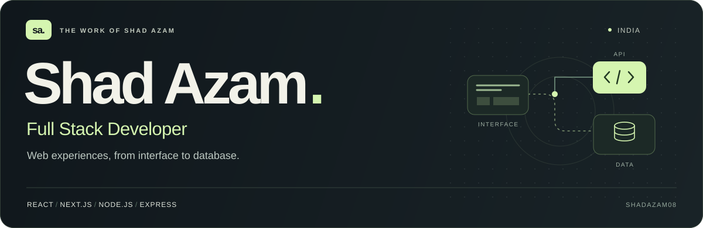
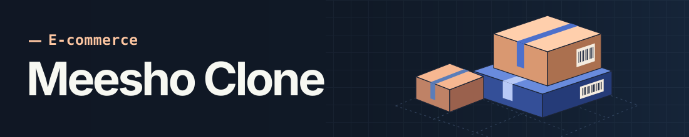
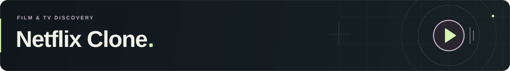
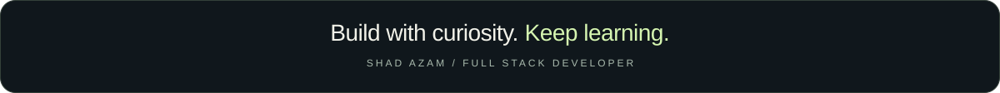

  <picture>
    <source media="(max-width: 600px)" srcset="./assets/profile-banner-mobile.svg" />
    
  </picture>

<h1 align="center">Hi, I'm Shad.</h1>

  A <strong>Full Stack Developer based in India</strong>, building web applications 
  with <strong>React, Next.js, Node.js and Express</strong>.

  Currently building <a href="https://github.com/shadazam08/tunesphere"><strong>TuneSphere</strong></a> and exploring <strong>TypeScript &amp; Generative AI</strong>.

  
  
  

  <a href="#selected-work">Selected work</a> &nbsp; / &nbsp;
  <a href="#tools-i-work-with">Skills</a> &nbsp; / &nbsp;
  <a href="#lets-connect">Contact</a>

---

## Selected work

### 01 / TuneSphere

**Music, playlists and playback in one place.**

A full-stack music streaming project with user authentication, playlist management and music streaming.

`React` `Next.js` `Node.js` `Express` `MongoDB`

**[Explore source →](https://github.com/shadazam08/tunesphere)**

 

### 02 / Meesho Clone

**From product discovery to order management.**

A Meesho-inspired e-commerce project covering product listings, authentication, a shopping cart and order management.

`React` `Node.js` `Express` `MongoDB`

**[Explore source →](https://github.com/shadazam08/meesho-colone)** &nbsp;·&nbsp; **[View demo ↗](https://meesho-colone.vercel.app/)**

 

### 03 / Netflix Clone

**A familiar interface, built to learn.**

A Netflix-inspired learning project with user authentication, search and filtering for movies and TV shows.

`React` `Node.js` `Express`

**[Explore source →](https://github.com/shadazam08/netflix-clone)** &nbsp;·&nbsp; **[View demo ↗](https://netflix-clone-nine-tawny.vercel.app/)**

 

[Browse all repositories →](https://github.com/shadazam08?tab=repositories)

## Tools I work with

| Area | Technologies |
| :--- | :--- |
| **Frontend** | JavaScript · React · Next.js · HTML · CSS · Bootstrap |
| **Backend** | Node.js · Express |
| **Databases** | MongoDB · PostgreSQL |

## Learning, one build at a time

- **Next.js & TypeScript:** stronger types and clearer application structure.
- **Generative AI:** exploring useful AI features for web applications.
- **GraphQL & UI/UX:** learning new API approaches and improving interface clarity.

Away from the keyboard, you'll usually find me following cricket or thinking about the next project.

## Let's connect

Have a role, project or collaboration in mind? **Let's talk.**

**[azamshad08@gmail.com](mailto:azamshad08@gmail.com)** &nbsp;·&nbsp; **[LinkedIn](https://linkedin.com/in/shad-azam-32180153)**

 

  

