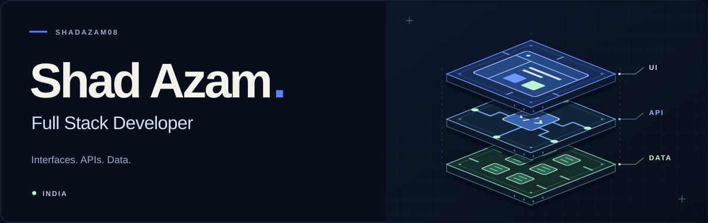
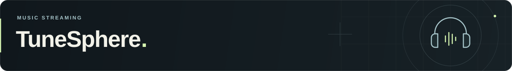

  <picture>
    <source media="(max-width: 600px)" srcset="./assets/hero-mobile.svg" />
    
  </picture>

I’m **Shad**, a full-stack developer in India. I build React interfaces and the Node.js services behind them. Two things I enjoy working on are how a listener saves a playlist and how a shopper’s cart becomes an order.

  
  
  

## Selected work

**TuneSphere** is the music app I’m building. Listeners can sign in, manage their own playlists and stream the tracks they want to hear.

`React` `Next.js` `Node.js` `Express` `MongoDB`

[Explore the TuneSphere source →](https://github.com/shadazam08/tunesphere)

 

**Meesho Clone** brings the shopping flow into one app. Shoppers can browse the catalog, sign in, add products to a cart and manage their orders.

`React` `Node.js` `Express` `MongoDB`

[Try the shopping demo ↗](https://meesho-colone.vercel.app/) &nbsp;·&nbsp; [Explore the source →](https://github.com/shadazam08/meesho-colone)

## Tech stack

| Area | Technologies |
| :--- | :--- |
| **Frontend** | HTML5 · CSS3 · JavaScript · React · Next.js · Bootstrap |
| **Backend & databases** | Node.js · Express · MongoDB · PostgreSQL |
| **Exploring & learning** | Generative AI · TypeScript · GraphQL |

- 🌱 **Learning:** TypeScript, deeper Next.js patterns and GenAI applications.
- 💬 **Ask me about:** JavaScript, React, Node.js, Express, MongoDB and PostgreSQL.

<!-- 
 -->
  ## Beyond the projects

I’m interested in how APIs fit together as an application grows, especially GraphQL and microservices. On the UI side, I like working out how to make the next step clearer for the person using the app.

🏏 **Beyond the keyboard:** Cricket and experimenting with new project ideas.

<!-- 
 -->

<!-- 
 -->
 ## GitHub activity & elsewhere

  

[Instagram](https://www.instagram.com/mshadazam/) &nbsp;·&nbsp; [Facebook](https://fb.com/shad.azam.94)

<!-- 
 -->

## Contact

For a full-stack role or a project you’d like to discuss, you can reach me here.

**[azamshad08@gmail.com](mailto:azamshad08@gmail.com)** &nbsp;·&nbsp; **[LinkedIn](https://linkedin.com/in/shad-azam-32180153)** &nbsp;·&nbsp; **[GitHub](https://github.com/shadazam08)**

 

  

